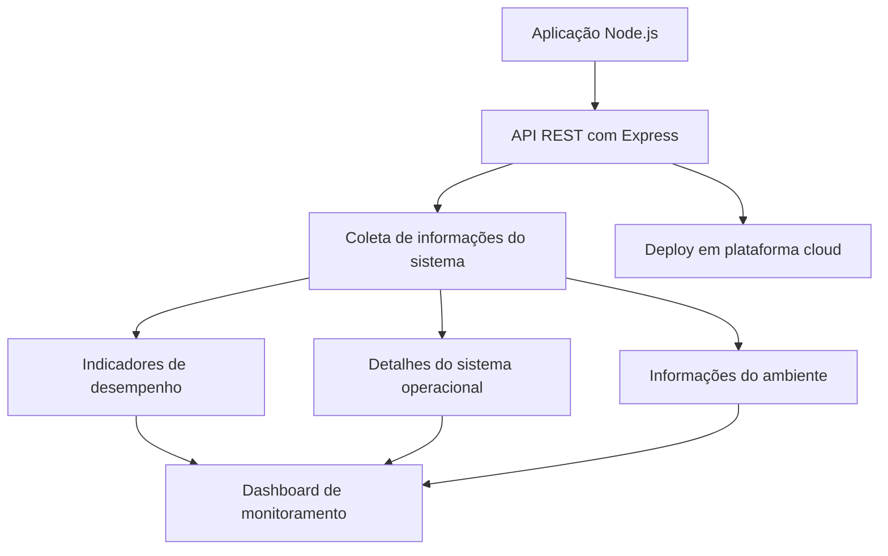
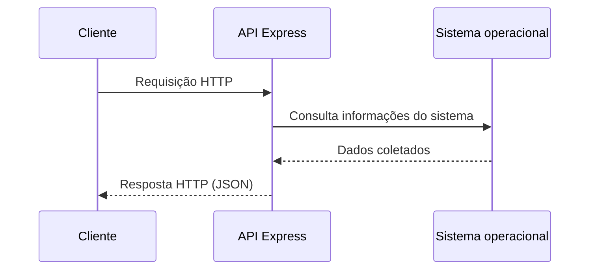
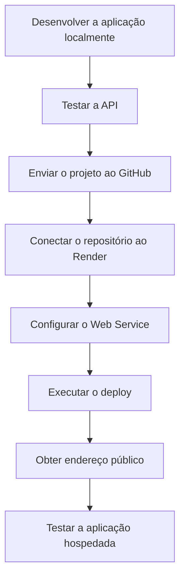
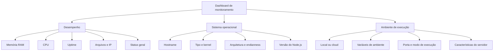

Aula 07 — Projeto: Nuvem e Sistemas Operacionais

> **Disciplina/tema:** Projeto — Nuvem e Sistemas Operacionais  
> **Docente:** Prof. Me. Deivison S. Takatu  
> **Contato informado no material:** deivison.takatu@fatec.sp.gov.br

---

## 🎯 1. Objetivos da aula

Esta aula propõe evoluir uma aplicação desenvolvida anteriormente com **Node.js** e **Express**, transformando-a em um dashboard de monitoramento do sistema operacional. O projeto também introduz a publicação de uma API REST em uma plataforma de hospedagem em nuvem — o **Render** — e propõe comparar essa plataforma com outra solução semelhante.

Ao final do estudo, espera-se compreender como:

- criar e executar uma API REST com Express;
- permitir, quando necessário, o acesso à API a partir de diferentes origens por meio de CORS;
- publicar um projeto versionado no GitHub;
- configurar um serviço web no Render;
- coletar e apresentar informações do sistema operacional;
- diferenciar execução local e execução em nuvem;
- comparar plataformas de hospedagem a partir de uma implantação prática.

## 🧭 2. Visão geral do projeto

Na aula anterior, a aplicação apresentava informações básicas da máquina, como hostname, plataforma, arquitetura, quantidade de CPUs, memória e tempo de atividade.

A proposta desta etapa é ampliar a aplicação para exibir informações de desempenho e detalhes do ambiente de execução em um painel visual.



O dashboard funciona como uma visão consolidada do ambiente computacional: em vez de consultar cada informação separadamente, o usuário consegue observar vários indicadores em um único painel.

---

## 🧰 3. Criando uma API REST com Express

### 3.1. Inicialização do projeto

Crie uma pasta para o projeto e abra-a no Visual Studio Code.

No terminal, inicialize o projeto Node.js:

```bash
npm init -y
```

Esse comando cria o arquivo `package.json`, utilizado para registrar informações do projeto, scripts e dependências.

### 3.2. Instalação do Express

Instale o Express.js:

```bash
npm install express
```

O **Express** é um framework para Node.js que facilita a criação de aplicações web e APIs. Ele fornece recursos para definir rotas, tratar requisições HTTP e enviar respostas.

### 3.3. Instalação do CORS

O material da aula apresenta o seguinte comando:

```bash
npm install cors express
```

Como o Express já foi instalado no passo anterior, também é possível instalar apenas o pacote CORS:

```bash
npm install cors
```

**CORS** significa *Cross-Origin Resource Sharing*. É um mecanismo de segurança implementado pelos navegadores para controlar requisições feitas por páginas web a recursos hospedados em uma origem diferente.

Uma origem é definida pela combinação de protocolo, domínio e porta. Por exemplo, uma página servida em `http://localhost:3000` e uma API em `http://localhost:4000` possuem origens diferentes.

O CORS não é um mecanismo de autenticação. Ele define quais origens de navegador podem acessar determinados recursos por meio de requisições cross-origin.

### 3.4. Organização dos arquivos

O roteiro da aula solicita a criação de um arquivo de aplicação e indica um exemplo de referência no GitHub. O slide menciona `api.js`, mas o comando de execução e o exemplo de deploy utilizam `index.js`. É importante manter o nome do arquivo consistente com o comando configurado.

Uma estrutura mínima possível é:

```text
projeto/
├── node_modules/
├── package.json
├── package-lock.json
└── index.js
```

Exemplo indicado no material:

- [Exemplo Express — Sistemas Operacionais (GitHub)](https://github.com/deivisontakatu/exemplo-express-so/blob/main/index.js)

### 3.5. Executando o servidor

O comando apresentado nos slides é:

```bash
node index.js
```

Esse comando executa o arquivo `index.js` com o Node.js. Se o arquivo principal tiver outro nome, o comando deverá corresponder a esse nome.

### 3.6. Fluxo básico de uma API REST

Uma API REST expõe recursos por meio de rotas HTTP. Um cliente envia uma requisição e o servidor processa a solicitação, podendo retornar dados — frequentemente em JSON.



Métodos HTTP comuns:

| Método | Uso habitual |
|---|---|
| `GET` | Consultar ou recuperar informações |
| `POST` | Enviar dados ou solicitar criação de recurso |
| `PUT` | Substituir um recurso |
| `PATCH` | Atualizar parcialmente um recurso |
| `DELETE` | Remover um recurso |

Para o dashboard proposto, uma rota de consulta (`GET`) é uma escolha natural para disponibilizar os indicadores do sistema.

---

## ☁️ 4. Render: hospedagem de aplicações na nuvem

O **Render** é apresentado na aula como uma plataforma moderna de hospedagem em nuvem. O material destaca suporte a Node.js, Python e outras linguagens, integração com repositórios Git e deploy contínuo.

Entre as características citadas nos slides estão:

- integração com repositórios Git;
- deploy automático após atualizações no repositório;
- planos gratuitos para projetos pequenos;
- interface simplificada;
- possibilidade de escalabilidade;
- certificado SSL;
- uso em APIs e microsserviços;
- monitoramento de desempenho.

O Render é utilizado no projeto para simular a execução de um serviço web em infraestrutura remota, permitindo comparar o comportamento da aplicação local com o ambiente hospedado.

> **Atenção:** disponibilidade de recursos, limites de planos, preços e comportamento de serviços gratuitos podem mudar. Consulte a documentação e as condições atuais da plataforma antes de planejar uma implantação.

Site da plataforma: [https://render.com](https://render.com)  
Painel: [https://dashboard.render.com](https://dashboard.render.com)

### 4.1. Benefícios destacados na aula

| Benefício | Significado no contexto do projeto |
|---|---|
| Deploy simplificado | Publicação do serviço por meio de uma configuração guiada |
| Integração com GitHub | O código fica associado a um repositório |
| Atualizações automáticas | Novas versões podem ser implantadas após alterações no repositório |
| Ambiente de produção | A aplicação fica acessível por um endereço remoto |
| Escalabilidade | A infraestrutura pode ser ajustada conforme a demanda, de acordo com o serviço e o plano |
| Monitoramento | A plataforma oferece recursos para acompanhar o serviço |

### 4.2. Fluxo de publicação



---

## 🚀 5. Publicando a API no Render

O roteiro da aula organiza o processo em cinco passos.

### Passo 1 — Fazer commit do projeto no GitHub

Disponibilize o projeto em um repositório do GitHub. O repositório deve conter os arquivos necessários para instalar e executar a aplicação, como `package.json` e o arquivo principal.

O fluxo básico com Git é:

```bash
git add .
git commit -m "Preparar projeto para deploy"
git push
```

### Passo 2 — Criar uma conta no Render

Acesse:

[https://dashboard.render.com](https://dashboard.render.com)

Crie ou acesse sua conta.

### Passo 3 — Criar um Web Service

No painel do Render:

1. selecione a opção **New**;
2. escolha **Web Service**;
3. conecte sua conta ou repositório do GitHub;
4. selecione o repositório que contém a aplicação.

### Passo 4 — Definir os comandos de execução

O slide apresenta esta configuração:

| Campo | Valor apresentado no material |
|---|---|
| Build Command | `node /` |
| Start Command | `node index.js` |

O comando de inicialização deve apontar para o arquivo principal real da aplicação. A configuração de build depende da estrutura do projeto e dos scripts definidos no `package.json`; portanto, revise os campos conforme a aplicação e as instruções atuais do Render, em vez de copiar um comando sem verificar sua finalidade.

### Passo 5 — Realizar o deploy

Após configurar o serviço, execute o deploy. Quando a publicação terminar, a aplicação poderá ser acessada por um endereço no formato:

```text
https://seu-projeto.onrender.com
```

O endereço efetivo será o atribuído ao serviço no painel do Render.

### 5.1. Verificação após o deploy

Depois da publicação:

- abra o endereço público do serviço;
- teste as rotas da API;
- verifique se a resposta contém os dados esperados;
- consulte os logs caso a aplicação não inicie;
- confirme se as configurações de porta e ambiente estão adequadas à plataforma.

---

## 📊 6. Evolução para um dashboard de monitoramento

A parte central do projeto consiste em ampliar a API e o painel para apresentar informações sobre o sistema operacional e os recursos computacionais.

O material organiza os dados em três grupos: indicadores de desempenho, detalhes do sistema operacional e informações do ambiente de execução.

### 6.1. Indicadores visuais de desempenho

A nova versão deve apresentar:

| Indicador | O que representa |
|---|---|
| Uso de memória RAM (%) | Percentual de memória utilizada em relação à memória considerada no cálculo |
| Uso médio da CPU | Indicador de utilização do processador |
| Uptime formatado | Tempo durante o qual o sistema está em funcionamento |
| Quantidade de arquivos do projeto | Número de arquivos identificados na estrutura do projeto |
| IP principal | Endereço IP selecionado como principal pela aplicação |
| Status geral da máquina | Síntese visual do estado do ambiente monitorado |

Esses indicadores funcionam como um painel executivo, permitindo interpretar rapidamente o estado do sistema.

**Cuidados de interpretação:**

- O percentual de memória depende da fórmula e das informações usadas pela aplicação.
- “Uso médio da CPU” precisa ter um intervalo ou método de cálculo definido para ser interpretável.
- Uptime representa tempo de atividade, não uma medida direta de desempenho.
- A contagem de arquivos depende dos diretórios incluídos e excluídos na varredura.
- Uma máquina pode possuir vários endereços IP; a escolha do “IP principal” depende do critério implementado.
- O status geral precisa ter regras explícitas. Não se deve assumir que um único indicador descreve toda a saúde do sistema.

### 6.2. Informações do sistema operacional

O dashboard também deve detalhar:

| Informação | Descrição |
|---|---|
| Nome da máquina | Identificação do host |
| Tipo do sistema | Plataforma ou família do sistema operacional |
| Versão do kernel | Versão do núcleo do sistema operacional |
| Arquitetura do processador | Arquitetura utilizada pelo ambiente, como x64 ou arm64 |
| Endianness | Ordem dos bytes utilizada na representação de dados |
| Versão do Node.js | Versão do runtime Node.js em execução |

Essas informações ajudam a caracterizar o ambiente no qual a aplicação está sendo executada e permitem discutir a relação entre hardware, software e sistema operacional.

### 6.3. Ambiente local e ambiente cloud

A aplicação deve identificar se está sendo executada localmente ou em um ambiente de nuvem, como o Render.

O painel deve apresentar informações como:

- variáveis de ambiente;
- porta utilizada;
- modo de execução;
- características do servidor remoto.

A comparação permite observar que a mesma aplicação pode ser executada em ambientes diferentes, com configurações e recursos distintos.

**Conceitos relacionados:**

- **Infraestrutura remota:** recursos computacionais acessados por rede, sem estarem necessariamente na máquina do desenvolvedor.
- **Serviço sob demanda:** recurso disponibilizado conforme a necessidade de uso.
- **Virtualização:** técnica que permite abstrair recursos físicos e executar ambientes computacionais isolados.
- **Variáveis de ambiente:** valores de configuração fornecidos ao processo sem precisar fixá-los diretamente no código.

> **Segurança:** não exponha segredos, tokens, senhas ou valores sensíveis de variáveis de ambiente no dashboard ou em respostas públicas da API. Exiba apenas informações apropriadas para diagnóstico.

### 6.4. Visão integrada do dashboard



### 6.5. Comparação entre execução local e em nuvem

| Aspecto | Execução local | Execução em nuvem |
|---|---|---|
| Local de execução | Máquina do desenvolvedor | Infraestrutura remota da plataforma |
| Acesso | Em geral, pela rede local ou pelo próprio computador | Pode ser acessada por um endereço público, conforme a configuração |
| Recursos | Dependem do hardware local | Dependem dos recursos disponibilizados pelo serviço |
| Configuração | Controlada diretamente pelo desenvolvedor | Parte da configuração é feita no painel e no ambiente da plataforma |
| Disponibilidade | Depende da máquina e da rede local | Depende da disponibilidade do provedor e da configuração do serviço |
| Atualização | Normalmente realizada no ambiente local | Pode ser automatizada pela integração com Git |

A comparação deve ser feita com observações reais obtidas durante a execução do projeto, e não apenas com suposições sobre as plataformas.

---

## 🧪 7. Atividade prática: comparar outra plataforma de hospedagem

A atividade proposta nos slides solicita escolher uma aplicação semelhante ao Render, realizar o deploy da aplicação e comparar as diferenças entre os servidores analisados.

### Etapas sugeridas

1. Escolha outra plataforma de hospedagem de aplicações.
2. Verifique se ela oferece suporte ao ambiente utilizado pelo projeto.
3. Crie uma conta, se necessário.
4. Conecte o repositório ou envie o projeto conforme o fluxo da plataforma.
5. Configure a execução da aplicação.
6. Realize o deploy.
7. Teste a API publicada.
8. Compare os resultados com os obtidos no Render.
9. Elabore um relatório com as diferenças observadas.

### Critérios para a comparação

| Critério | O que observar |
|---|---|
| Facilidade de configuração | Quantidade e complexidade das etapas para publicar |
| Integração com Git | Como a plataforma conecta o repositório |
| Comandos de build e start | Como são definidos os comandos de instalação e inicialização |
| Suporte tecnológico | Compatibilidade com Node.js e demais tecnologias do projeto |
| Endereço e HTTPS | Como o serviço é disponibilizado e protegido por HTTPS |
| Logs e monitoramento | Quais informações estão disponíveis para diagnóstico |
| Recursos e limites | Limites de uso, capacidade e condições do plano |
| Escalabilidade | Como a plataforma trata aumento de demanda |
| Atualizações | Como uma nova versão é publicada |
| Experiência de uso | Clareza do painel e facilidade de manutenção |

### Modelo de relatório comparativo

O relatório pode seguir esta estrutura:

1. **Introdução:** objetivo da comparação e apresentação das plataformas.
2. **Metodologia:** descrição da aplicação utilizada e das etapas de implantação.
3. **Configuração:** requisitos, comandos e ajustes necessários em cada plataforma.
4. **Resultados:** funcionamento da API, acesso, logs e indicadores observados.
5. **Comparação:** diferenças e semelhanças segundo os critérios definidos.
6. **Conclusão:** avaliação fundamentada sobre as plataformas para o projeto realizado.

Não declare que uma plataforma é “melhor” sem indicar os critérios e as evidências que sustentam essa conclusão.

---

## 🧠 8. Conceitos essenciais para revisar

| Conceito | Síntese |
|---|---|
| Node.js | Ambiente de execução de JavaScript fora do navegador |
| Express | Framework para construir aplicações web e APIs em Node.js |
| API REST | Interface que disponibiliza recursos por meio de convenções e métodos HTTP |
| CORS | Mecanismo que controla o acesso do navegador a recursos de outra origem |
| Git | Sistema de controle de versão |
| GitHub | Serviço de hospedagem e colaboração em repositórios Git |
| Deploy | Processo de disponibilizar uma aplicação em um ambiente de execução |
| Cloud computing | Uso de recursos computacionais disponibilizados por infraestrutura remota |
| Web Service | Serviço web acessível por meio de protocolos de rede |
| Uptime | Tempo durante o qual um sistema permanece em funcionamento |
| Kernel | Núcleo do sistema operacional, responsável por gerenciar recursos fundamentais |
| Endianness | Ordem dos bytes na representação de valores multibyte |
| Variável de ambiente | Configuração disponibilizada ao processo por meio do ambiente de execução |

## ✅ 9. Checklist de entrega do projeto

- [ ] Projeto Node.js organizado e com dependências registradas.
- [ ] API REST implementada com Express.
- [ ] CORS configurado quando necessário para o cenário de acesso.
- [ ] Aplicação executando localmente.
- [ ] Repositório publicado no GitHub.
- [ ] Web Service criado no Render.
- [ ] Deploy concluído e endereço público testado.
- [ ] Dashboard com indicadores de desempenho.
- [ ] Dashboard com informações do sistema operacional.
- [ ] Identificação do ambiente local ou cloud.
- [ ] Segunda plataforma escolhida e testada.
- [ ] Relatório comparativo elaborado com evidências.

---

## 📚 10. Referências

Referências bibliográficas apresentadas nos slides:

- TANENBAUM, Andrew S.; BOS, Herbert. *Sistemas Operacionais Modernos*. 4. ed. São Paulo: Pearson, 2016.
- SILBERSCHATZ, Abraham; GALVIN, Peter B.; GAGNE, Greg. *Fundamentos de Sistemas Operacionais*. 9. ed. Rio de Janeiro: LTC, 2015.
- STALLINGS, William. *Sistemas Operacionais: Conceitos e Projetos*. 8. ed. São Paulo: Pearson, 2015.
- DENARDIN, G. W.; BARRIQUELLO, C. H. *Sistemas Operacionais de Tempo Real e sua Aplicação em Sistemas Embarcados*. Porto Alegre: Editora da UFRGS, 2014.
- AWASTHI, A.; RAWAT, V. *Ramificação e Tarefas do Sistema Operacional*. Edições Nosso Conhecimento, 2023.
- DOWNEY, Allen B. *Think OS: A Brief Introduction to Operating Systems*. Green Tea Press, 2015.
- RED HAT. *Red Hat Enterprise Linux – System Administration Guide*. Documentação oficial.
- DOCKER INC. *Docker Documentation*. Documentação oficial. Disponível em: [https://docs.docker.com](https://docs.docker.com).

Materiais e plataformas citados na aula:

- [Exemplo Express — Sistemas Operacionais](https://github.com/deivisontakatu/exemplo-express-so/blob/main/index.js)
- [Render](https://render.com)
- [Painel do Render](https://dashboard.render.com)

---

*Material organizado a partir da apresentação “Aula 07 — Projeto Nuvem e Sistemas Operacionais”. As explicações complementares foram estruturadas para estudo e execução da atividade; configurações específicas da plataforma devem ser conferidas na documentação vigente.*
"""
out = Path("/mnt/data/Aula_07_Projeto_Nuvem_e_Sistemas_Operacionais.md")
out.write_text(md, encoding="utf-8")
print(f"Arquivo criado: {out} | {out.stat().st_size} bytes")
