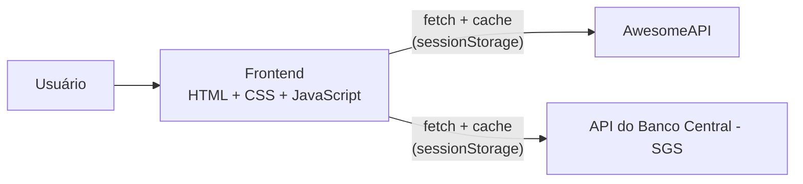
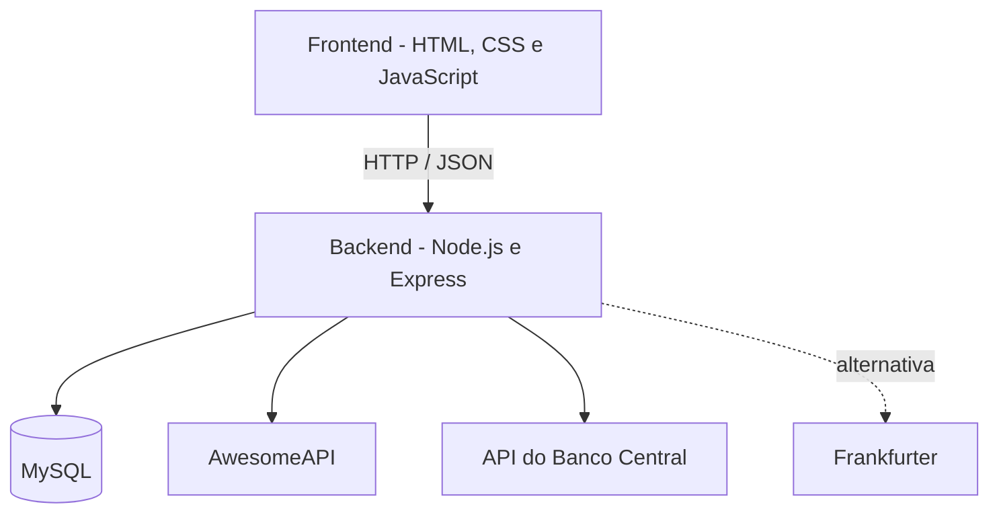

# MoneyMap — Explorador Econômico
Acesse em: https://money-map-so.netlify.app/
Aplicação web para **visualizar, converter e comparar informações econômicas**, com foco em moedas, câmbio e indicadores brasileiros (IPCA e Selic).

> **Aviso:** o MoneyMap é uma plataforma informativa e de visualização de dados. Não é corretora, banco nem serviço de recomendação financeira, e não realiza operações, investimentos ou transações reais.

## Status do projeto

| Etapa | Conteúdo | Situação |
|-------|----------|----------|
| 1 | Frontend: Dashboard, Conversor, Histórico, Comparador e Indicadores, integrados às APIs externas | ✅ Concluída |
| 2 | Backend Node.js + Express (rotas, serviços, cache, validação) | ⏳ Planejada |
| 3 | Banco MySQL, cadastro/login, favoritos e histórico de conversões | ⏳ Planejada |
| 4 | Testes finais, melhorias de interface e deploy | ⏳ Planejada |

Hoje o projeto funciona **somente com o frontend**, que consulta as APIs públicas diretamente pelo navegador. A página **Favoritos** ainda é um aviso, pois depende de login e banco de dados (Etapas 2 e 3).

---

## 1. Objetivo

Oferecer uma interface com aparência de produto financeiro profissional para consultar cotações, converter valores, analisar a evolução histórica do câmbio e acompanhar indicadores econômicos do Brasil, sempre informando a **fonte** e a **data/hora** de cada dado.

Também serve como projeto de portfólio, demonstrando:

- desenvolvimento frontend (HTML, CSS e JavaScript);
- consumo e integração de APIs REST e manipulação de JSON;
- visualização de dados com gráficos;
- tratamento de erros, cache e organização de código;
- (nas próximas etapas) backend, modelagem relacional, autenticação e deploy.

## 2. Problema que pretende resolver

Informações sobre câmbio e indicadores econômicos estão espalhadas em fontes diferentes, com formatos, periodicidades e significados distintos. Isso gera confusão frequente, por exemplo:

- tratar uma cotação de referência diária como se fosse "tempo real";
- confundir a **Selic efetiva diária** (série SGS 11) com a **meta Selic** definida pelo Copom;
- comparar valores nominais de moedas com escalas diferentes, em vez de comparar variações percentuais.

O MoneyMap reúne essas informações em um só lugar, de forma clara, identificando o tipo de cotação (compra), a fonte, a periodicidade e a data de atualização.

## 3. Escopo

### Dentro do escopo (Nível 2 do planejamento)

- Dashboard com cotações, variações e gráficos.
- Conversor de moedas.
- Histórico de câmbio com estatísticas do período.
- Comparador de moedas com séries normalizadas.
- Indicadores IPCA e Selic.
- *(Planejado)* Backend próprio, MySQL, cadastro e login, favoritos e histórico de conversões.

### Fora do escopo

- Operações bancárias, compra/venda de moedas, investimentos ou qualquer transação real.
- Recomendações financeiras.
- Cotações em tempo real garantido.

### Possíveis extensões (Nível 3)

Alertas de cotação, relatórios em PDF, calculadora de inflação, notícias econômicas e simulador de valorização histórica.

## 4. Requisitos funcionais

| ID | Requisito | Situação |
|----|-----------|----------|
| RF01 | Exibir cotação, variação absoluta e percentual, indicador de alta/queda, data/hora e mini-gráfico para USD, EUR, GBP e BTC em relação ao real | ✅ |
| RF02 | Exibir gráfico de evolução do dólar com períodos de 7, 30, 90, 180 dias e ~1 ano | ✅ |
| RF03 | Converter valores entre BRL, USD, EUR, GBP, JPY, ARS e BTC, com botão para inverter as moedas e exibição da taxa e do horário da cotação | ✅ |
| RF04 | Validar o valor digitado (vazio, inválido, negativo, separadores `.` e `,`) e tratar moedas iguais | ✅ |
| RF05 | Mostrar o histórico de uma moeda com cotação inicial, final, maior, menor, variação percentual e gráfico | ✅ |
| RF06 | Comparar duas ou três moedas (USD, EUR, GBP, JPY) com séries normalizadas (início = 100), tabela e variação no período | ✅ |
| RF07 | Exibir IPCA mensal, IPCA acumulado em 12 meses e Selic efetiva diária, com explicação e periodicidade | ✅ |
| RF08 | Informar fonte e data/hora dos dados e exibir mensagens de erro quando uma API estiver indisponível | ✅ |
| RF09 | Cadastro, login e logout de usuários | ⏳ Etapa 3 |
| RF10 | Adicionar, remover e listar moedas favoritas com a cotação mais recente | ⏳ Etapa 3 |
| RF11 | Salvar e consultar o histórico de conversões do usuário | ⏳ Etapa 3 |

## 5. Requisitos não funcionais

| ID | Requisito | Como é atendido |
|----|-----------|-----------------|
| RNF01 | **Transparência dos dados** | Os valores são de **compra** (`bid`) da AwesomeAPI e são rotulados como tal; nenhuma cotação é apresentada como tempo real garantido; a Selic é identificada como efetiva diária, não como meta |
| RNF02 | **Resiliência** | Timeout de 10 s nas requisições, blocos `try/catch` e mensagens amigáveis quando uma fonte falha; dados indisponíveis nunca são substituídos por valores inventados |
| RNF03 | **Desempenho** | Cache no navegador (`sessionStorage`) com validade de 1 min para cotações, 5 min para históricos e 1 h para séries do Banco Central |
| RNF04 | **Responsividade** | Layout adaptado a computador, tablet e celular; a sidebar vira barra inferior em telas pequenas |
| RNF05 | **Usabilidade e acessibilidade** | Identidade visual escura e consistente, rótulos `aria-label`, foco visível no teclado e respeito à preferência por menos movimento |
| RNF06 | **Precisão** | Formatação numérica em pt-BR; casas decimais adequadas por moeda (8 para BTC); IPCA acumulado calculado pelo produto dos fatores mensais |
| RNF07 | **Manutenibilidade** | Código separado em camada de acesso às APIs (`api.js`), um script por página e estilos modulares |
| RNF08 | **Compatibilidade** | Navegadores modernos com suporte a ES2020+ (Chrome, Edge, Firefox e Safari atuais) |
| RNF09 | **Segurança** *(planejado)* | Senhas com hash (bcrypt/Argon2), credenciais em variáveis de ambiente, validação de entradas no backend |

## 6. Tecnologias utilizadas

### Em uso (Etapa 1)

| Tecnologia | Função |
|------------|--------|
| HTML5 | Estrutura das páginas |
| CSS3 | Layout (Flexbox e Grid), tema escuro, responsividade e animações leves |
| JavaScript (ES2020+) | Lógica, cálculos, manipulação do DOM e `fetch` com `async/await` |
| [Chart.js 4.4.1](https://www.chartjs.org/) | Gráficos de linha e barras (via CDN) |
| [Lucide 0.446.0](https://lucide.dev/) | Ícones (via CDN) |
| Google Fonts (Manrope) | Tipografia |

### Fontes de dados

| Fonte | Uso |
|-------|-----|
| [AwesomeAPI](https://docs.awesomeapi.com.br/api-de-moedas) | Cotações atuais (`/json/last`) e histórico diário (`/json/daily`, máximo de 360 dias) |
| [Banco Central do Brasil — SGS](https://api.bcb.gov.br/) | Selic efetiva diária (série 11) e IPCA mensal (série 433) |

### Planejadas

Node.js e Express (backend), MySQL (persistência), bcrypt (senhas), Day.js (datas) e Frankfurter como fonte alternativa de câmbio.

## 7. Arquitetura da aplicação

### Arquitetura atual (Etapa 1)

O frontend é estático e consulta as APIs externas diretamente, com cache local:



### Arquitetura alvo (Etapas 2 e 3)

Um backend próprio centralizará as consultas externas, o cache, a validação e o acesso ao banco:



Motivos para adicionar o backend: centralizar requisições externas, tratar respostas inconsistentes, ter cache compartilhado, proteger eventuais chaves de API e conectar o sistema ao MySQL (usuários, favoritos e conversões).

### Fluxo de uma consulta (arquitetura atual)

1. O usuário abre uma página (por exemplo, o Dashboard).
2. O script da página chama uma função de `api.js`.
3. `getJSON()` verifica o cache em `sessionStorage`; se estiver válido, devolve o dado salvo.
4. Caso contrário, faz a requisição com timeout de 10 s e guarda a resposta.
5. `api.js` converte os campos da API externa para um formato padronizado (`code`, `name`, `price`, `change`, `pct`, `date`).
6. O script da página atualiza cards, tabelas e gráficos, ou exibe uma mensagem de erro.

## 8. Organização dos componentes

```text
MoneyMap/
├── frontend/
│   ├── index.html              # Dashboard
│   ├── pages/
│   │   ├── converter.html      # Conversor de moedas
│   │   ├── history.html        # Histórico de câmbio
│   │   ├── comparison.html     # Comparador de moedas
│   │   ├── indicators.html     # Indicadores econômicos
│   │   └── favorites.html      # Favoritos (aguarda backend e banco)
│   ├── css/
│   │   ├── global.css          # Variáveis de cor, reset e layout base
│   │   ├── components.css      # Sidebar, topbar, cards, formulários e botões
│   │   ├── dashboard.css       # Cards de cotação, gráficos e indicadores
│   │   └── responsive.css      # Regras para tablet e celular
│   ├── js/
│   │   ├── api.js              # Acesso às APIs, cache, formatação e utilitários
│   │   ├── dashboard.js
│   │   ├── converter.js
│   │   ├── history.js
│   │   ├── comparison.js
│   │   └── indicators.js
│   └── assets/                 # Imagens e ícones
└── README.md
```

As pastas `backend/` e `database/` (com `schema.sql`) serão criadas nas Etapas 2 e 3.

### Principais componentes

| Componente | Responsabilidade |
|------------|------------------|
| `api.js` | Camada de acesso: `getLatest`, `getHistory`, `getRate` (AwesomeAPI) e `getSeries` (Banco Central); `getJSON` com timeout e cache; formatadores pt-BR; cálculos de IPCA acumulado e Selic anualizada; opções base dos gráficos |
| `dashboard.js` | Cards de cotação com mini-gráficos, gráfico principal com seleção de período, indicadores e tabela de moedas |
| `converter.js` | Leitura e validação do valor, conversão usando o BRL como moeda ponte e inversão de moedas |
| `history.js` | Estatísticas do período (inicial, final, maior, menor, variação) e gráfico |
| `comparison.js` | Seleção de duas ou três moedas, alinhamento das datas em comum e normalização (`índice = valor / valor inicial × 100`) |
| `indicators.js` | IPCA mensal e acumulado em 12 meses, Selic efetiva diária e gráficos |

### Fórmulas utilizadas

- Conversão: `valor convertido = valor original × taxa`
- Taxa entre duas moedas via BRL: `taxa(A→B) = cotação(A-BRL) / cotação(B-BRL)`
- Variação percentual: `((valor final − valor inicial) / valor inicial) × 100`
- Normalização: `índice = (valor na data / valor inicial) × 100`
- IPCA acumulado: `(Π (1 + mensal/100) − 1) × 100`
- Selic anualizada (estimativa): `((1 + diária/100)^252 − 1) × 100`

## 9. Pré-requisitos

- Navegador moderno (Chrome, Edge, Firefox ou Safari atualizados).
- Conexão com a internet (para as APIs e as bibliotecas carregadas por CDN).
- [Git](https://git-scm.com/) para clonar o repositório.
- Um servidor HTTP local para servir os arquivos estáticos. Use **uma** das opções:
  - extensão **Live Server** do VS Code;
  - [Node.js](https://nodejs.org/) 18 ou superior (para usar `npx serve`);
  - Python 3 (para usar `python -m http.server`).

> Para as próximas etapas serão necessários também Node.js e MySQL, mas **não são exigidos para executar a versão atual**.

## 10. Instalação

```bash
git clone https://github.com/<seu-usuario>/MoneyMap.git
cd MoneyMap
```

A versão atual não tem dependências para instalar: as bibliotecas (Chart.js e Lucide) são carregadas por CDN e não há `npm install`.

## 11. Configuração

Não há variáveis de ambiente nem chaves de API nesta etapa. As URLs das fontes ficam no início de `frontend/js/api.js`:

```js
const AWESOME = "https://economia.awesomeapi.com.br/json";
const BCB = "https://api.bcb.gov.br/dados/serie/bcdata.sgs";
```

Os tempos de cache são definidos no parâmetro `ttl` de cada chamada a `getJSON()` (60 s para cotações, 5 min para histórico de câmbio e 1 h para séries do Banco Central).

> **Backend e banco (Etapas 2 e 3):** quando forem implementados, as credenciais do MySQL e demais segredos ficarão em um arquivo `.env`, que **não deve ser versionado** (incluir no `.gitignore`). Os passos de configuração serão documentados aqui.

## 12. Execução

Na pasta `frontend`, inicie um servidor local usando uma das opções:

```bash
cd frontend

# Opção A: Node.js
npx serve .

# Opção B: Python
python -m http.server 5500
```

Ou, no VS Code, clique com o botão direito em `frontend/index.html` e escolha **Open with Live Server**.

Depois, abra o endereço exibido no terminal (por exemplo, `http://localhost:3000` com `serve` ou `http://localhost:5500` com Python).

**Evite abrir o `index.html` com duplo clique** (protocolo `file://`): o navegador pode bloquear as requisições às APIs.

## 13. Limitações conhecidas

- As cotações exibidas são de **compra** (`bid`) da AwesomeAPI. Sem chave de API, as respostas têm cache de cerca de 1 minuto no servidor da AwesomeAPI.
- O histórico diário da AwesomeAPI é limitado a **360 dias** por consulta (por isso o rótulo "~1 ano").
- A Selic exibida é a **efetiva diária** (SGS 11), não a meta do Copom; o valor anualizado é uma estimativa.
- O Comparador usa apenas as datas em que todas as moedas selecionadas têm cotação.
- Se uma fonte estiver fora do ar, a página mostra uma mensagem de erro; nenhum dado fictício é exibido.
- A Etapa 1 não possui testes automatizados.

## 14. Referências

- [AwesomeAPI — moedas](https://docs.awesomeapi.com.br/api-de-moedas)
- [Banco Central — dados abertos](https://dadosabertos.bcb.gov.br/) e [API SGS](https://api.bcb.gov.br/)
- [Frankfurter](https://frankfurter.dev/)
- [Chart.js](https://www.chartjs.org/docs/latest/) · [Lucide](https://lucide.dev/) · [Node.js](https://nodejs.org/docs/latest/api/) · [Express](https://expressjs.com/) · [MySQL](https://dev.mysql.com/doc/)
